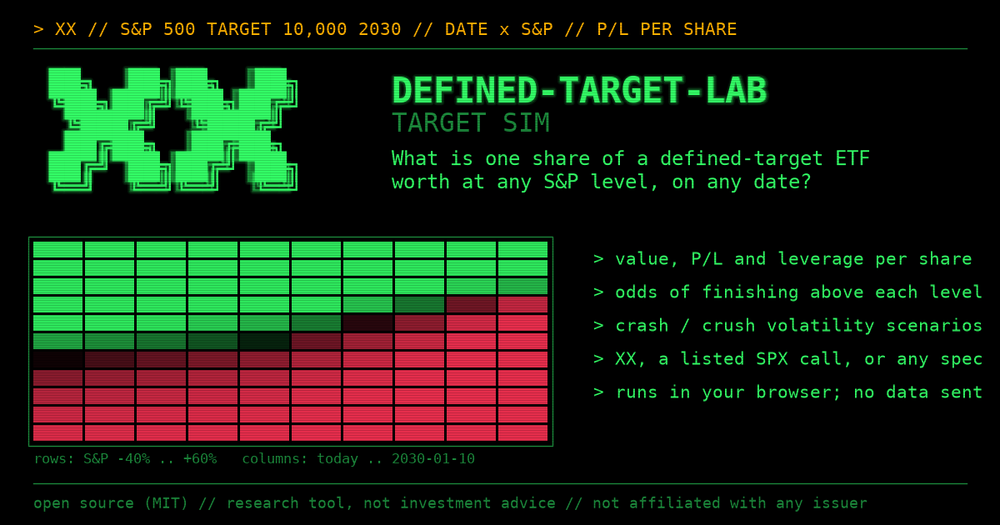

# defined-target-lab

**Simulate, calculate and forward-test the Roundhill XX ETF (S&P 500® Target 10,000 2030) and other
defined-target call ETFs.**

**[Open the browser simulator](https://ossilon.github.io/defined-target-lab/web/)**: no install, and nothing you
type leaves your browser.

[](https://ossilon.github.io/defined-target-lab/web/)

These tools price, forward-test and simulate defined-target call ETFs. The first fund is XX, which targets the
S&P 500 at 10,000 by 2030. No issuer sponsors this project. It gives no investment advice.

> This project provides general information only. Roundhill Investments and S&P Dow Jones Indices do not
> sponsor, endorse or affiliate with it. S&P Dow Jones Indices owns the "S&P 500" trademark. The fund names and
> tickers belong to their owners. Nothing here recommends a purchase or a sale. It ignores your objectives,
> finances and needs. Read the fund's prospectus before you invest.

## What is a defined-target call ETF?

A **defined-target call ETF** spends almost all its money on one batch of long-dated call options. The options
share one strike and one expiry. The strike sets a "target" level of an index: for XX, the S&P 500 at 10,000. The
expiry sets the "target date": January 10, 2030.

**At the target date** each share is worth about *(options per share) × max(ETF price − strike, 0)*, plus a small
cash balance. Below the target, the holder loses almost everything. Above it, gains grow point for point.

**Before the target date** the share acts as a leveraged bet. Its leverage changes every day. Volatility and
interest rates move its price.

**When the date arrives** the fund rolls into a new target and date.

### How it differs from its neighbors

| | Leverage | Can it go to ~zero? | Expiry |
|---|---|---|---|
| Daily-reset leveraged ETF (e.g., a 3x S&P fund) | Fixed (3x), resets daily | Rarely; it decays when markets chop | None |
| Buffer / defined-outcome ETF | Below 1x, upside capped | No | Yearly outcome periods |
| DIY LEAPS call | You choose | Yes | Yes |
| **Defined-target call ETF (XX)** | Changes daily (~5.6x in Oct 2026) | **Yes, below the target** | **Yes, then rolls** |

### A lottery ticket or a leveraged bet?

Investors may treat XX as a lottery ticket: a small sum that could return five or ten times its cost. Option
prices describe a different instrument. At the 2026-10-13 price, XX functions mainly as a leveraged bet that the
S&P 500 grows about 10% a year until January 2030, and the bet carries about a 61% risk-neutral chance of a
near-total loss.

| Outcome for a buyer at NAV on 2026-10-13 | Required S&P 500 price growth per year | Risk-neutral odds in listed option prices |
|---|---|---|
| Options expire worthless; about 1% cash remains | below 7.9% | about 61% |
| Recovers the purchase price | 9.8% or more | about 29% |
| Doubles | 11.6% or more | about 21% |
| Returns 5× | 16.6% or more | about 7% (3-11% across the bid/ask quotes) |
| Returns 10× | 24.1% or more | about 1% (extrapolated beyond the last listed strike) |

The 5× and 10× outcomes require the S&P 500 to compound at 17-24% a year for more than three years. Listed option
prices assign them odds of about 7% and 1%, but wide quotes leave these two rows uncertain: they do not differ
reliably from the simple model's 7.9% and 1.8%. Risk-neutral odds measure prices, not forecasts: if stocks
outperform cash, the real-world odds run higher. The figures come from one snapshot of delayed quotes (F10). A later
study measures how often the S&P 500 has delivered such growth.

## XX ETF: headline facts

The code here computes each fact from the issuer's public daily files and public market data.
[FINDINGS.md](FINDINGS.md) records each method. The figures cover the first closes after launch (2026-09-30 to
2026-10-13). The daily report updates them.

- **Each XX share holds call options on 0.48 SPY shares** (strike $995.01, expiration 2030-01-10) plus about 1%
  cash. New money buys options in proportion, so fund flows do not change a buyer's exposure per share. (F1, F3)
- **The option's price implies a volatility of about 16.5-16.9%.** The pricing vendor's interest rate drives most
  of the uncertainty in that number: +0.5 points of rate ≈ −0.8 points of volatility. (F6, F9)
- **Leverage runs about 5.6×**: a 1% SPY move moves NAV about 5.6%. **Volatility counts as much**: one volatility
  point moves NAV about 10%, and one percentage point of interest rates moves it about 15%. (F6)
- **The finish line sits near S&P 9,995**, not exactly 10,000, because SPY's price does not equal S&P/10. The
  range spans about 9,955-10,040, depending on how much history the estimate uses. (F7)
- **A buyer at NAV on 2026-10-13 needs the S&P near 10,560 on the target date to recover the purchase price.** That
  takes about 9.8% price growth a year; reaching the strike alone takes 7.9%. The report's simple odds model uses
  one volatility for every outcome and puts the risk-neutral chance of finishing above the strike near 29%. Its
  "10% mean total return" row still leaves the options worthless 52% of the time: a mean is not the typical path,
  and that row's median path grows only 7.4% a year in price. The options become more likely than not to pay off
  only near a 12% mean total return (median price growth 9.4%). (daily report, F6)
- **The listed S&P 500 options price the odds differently.** On 2026-10-13, call spreads on the Dec-2029 calls put
  the risk-neutral chance of finishing above 10,000 near 39% (simple model: 29%) and the chance of breaking even
  near 29% (simple model: 23%). The volatility skew causes the gap: it moves probability toward modest wins. For
  5× and 10× outcomes the quotes leave too much uncertainty to separate the two models. One snapshot of delayed
  quotes. (F10)
- **On 2026-10-13, XX fell 2.3% while SPY held flat.** The day before was a creation day, when the fund's mark
  comes from its own purchase price; the mark fell back the next day (hypothesis H1 tests this pattern). The daily
  report books such a move as a fall in implied volatility (96% of it), because the attribution assigns any repricing
  of the option to volatility. (daily report)
- **Speed**: one CPU core of an Intel Core i7-13700K (16 cores, 24 threads) prices 1 million options in 0.033 s
  and solves 1 million implied volatilities in 0.34 s (median of 7 runs; single-threaded numba 0.68, Python 3.13).
  The remaining cores stay free; v0.1 does not run in parallel.

## Tools

| Tool | Command (from the repository folder) |
|---|---|
| **Browser simulator** (v0.2): a date × S&P grid of one share's P/L, value or leverage, with the odds of finishing above each level, volatility scenarios, and presets for XX, a listed S&P 500 call or any fund you describe. No install; nothing you type leaves your browser. | [open it online](https://ossilon.github.io/defined-target-lab/web/), or open [web/index.html](web/index.html) from a copy ([how to read it](docs/learn/05-the-simulator.md)); [the self-test](https://ossilon.github.io/defined-target-lab/web/selftest.html) checks its maths against the Python engine |
| **"What must the S&P do?" calculator**: computes break-evens, a payoff table and odds across growth assumptions. Runs without downloaded data. | `py -m definedtarget calc --price 25 --spot 760 --iv 0.17 --rate 0.048 --as-of 2026-10-01` |
| **Daily tracker / forward test**: downloads the issuer's public files, checks the accounting, prices the option and writes a one-page report. A new copy prices each close from the first day it runs; to price earlier closes, add SPY's past closes ([data/README.md](data/README.md)) | `py -m definedtarget daily` then `py -m definedtarget report` |
| **Prospectus illustration**: recomputes the prospectus table | `py -m definedtarget prospectus` |
| **Pre-registered predictions**: a hash-chained ledger of testable claims about XX's behavior | [forward/HYPOTHESES.md](forward/HYPOTHESES.md) |
| **Verdicts**: computes each prediction's verdict from its frozen rule (provisional numbers before its review date); records a verdict only when asked | `py -I scripts/verdicts.py` |
| **Plain-English explainers** | [docs/learn/](docs/learn/01-what-is-a-call.md) |


## Install and run

Install Python 3.10+ with numpy, pandas, numba and scipy (scipy runs the verdicts' Welch tests; openpyxl is needed
only to read saved Cboe FLEX reports).

```
pip install numpy pandas numba scipy
py -m definedtarget calc --price 25 --spot 760 --iv 0.17 --rate 0.048 --as-of 2026-10-01
py tests/run_tests.py
```

For the daily tracker, read [data/README.md](data/README.md). The scripts download the issuer's public files and
public market data into your own `data/` folder. Run every script that reads downloaded files with `py -I`
(isolated mode), e.g., `py -I scripts/daily.py`.

To install the package itself, run `pip install .` from the repository folder (`pip install .[flex]` adds
openpyxl). The `definedtarget calc` and
`prospectus` commands then work from any folder; `daily` and `report` read and write the repository's `data/` and
`forward/` folders, so run them from a copy of the repository. [CHANGELOG.md](CHANGELOG.md) lists each release;
[LICENSE](LICENSE) gives the MIT terms.

## Check the freeze

The predictions mean something only if they existed before the data that tests them. The first 21 lines of
`forward/predictions.jsonl` hold protocol P1 and the 20 hypotheses, frozen on 2026-10-14 (each entry records its
UTC time).
OpenTimestamps anchors the SHA-256 of those exact bytes, `bc2b73a352bb46ebebf184ee4fdbbb13a7576c22fbba259e897d9c96d0e8888b`,
in the Bitcoin blockchain. To check it:

1. Copy the first 21 lines, byte for byte, into a file named `predictions_2026-10-14.jsonl`:
   `py -c "d=open('forward/predictions.jsonl','rb').readlines()[:21]; open('predictions_2026-10-14.jsonl','wb').write(b''.join(d))"`
2. Verify that file against `forward/predictions_2026-10-14.jsonl.ots` with the OpenTimestamps client
   (`ots verify`) or on opentimestamps.org. The proof shows the date of the Bitcoin block.

Protocol P2 (clarifications that change no band) follows as line 22, appended on 2026-10-15; the ledger records the
append before the first capture of a test-period close. A second proof, `forward/predictions_2026-10-15.jsonl.ots`,
covers the first 22 lines (SHA-256 `a213dfabc265a43a3a88e8b5e96529dc402df60675fb8316d22b6127d45f339e`): repeat the
steps with `[:22]` and the name `predictions_2026-10-15.jsonl`. That proof was stamped later the same day, so it
shows that P2 existed by then, not that it came before the capture. Verdicts append below and never change earlier lines. The test
`tests/test_ledger.py` pins both sets of bytes, and `.gitattributes` stops git from changing their line endings.

## How the model works (short version)

- **Option value**: Black-76 (the Black-Scholes formula written with the forward price) prices the SPY option. It
  projects SPY's quarterly dividends as discrete payments and discounts with the US Treasury curve, bootstrapped
  from par yields. The report shows a financing spread over Treasuries as a sensitivity.
- **Implied volatility**: the solver backs it out of the issuer's daily option mark. The code scales the
  **Greeks** to one fund share.
- **Odds**: a lognormal model at the option's implied volatility computes them twice: under the market's own
  (risk-neutral) pricing and under several assumed future returns. The report shows them side by side. The model
  ignores the volatility skew; F10 compares it with the odds in listed S&P 500 option prices.
- **Checks**: the code rebuilds each day's NAV from the holdings. A broken identity, a stale input, a failed
  latest-day download or a changed fund document stops the run; a revised holdings file or a close without an SPY
  price adds a note. No failure passes silently.

[ASSUMPTIONS.md](ASSUMPTIONS.md) and [FUND_FACTS.md](FUND_FACTS.md) list every assumption and its status.

## What this cannot tell you

- Whether the S&P 500 closes above 10,000 on January 10, 2030.
- The prices the fund pays and receives in trades (the issuer publishes only its model marks).
- The roll rule for the next target period (unpublished).
- Your tax position.

## Data, licenses and attribution

- This repository contains no data. The scripts download each user's own copy.
- Fund files: Roundhill Investments' public website (informational use; republishing requires their permission).
- Volatility indices: Cboe. Interest rates: US Treasury (public domain). SPY dividends and past closes: files each
  user adds from a source they may use (data/README.md). F10's listed-option quotes: the author's TradingView
  account (display-only license; the repository holds only derived figures).
- Code: MIT license, provided "as is", without warranty.

## Feedback

Open an issue to report a bug, question a number or suggest a feature. Corrections to the findings matter most:
each one comes with its method, so anyone can check it.

## How to cite

If you use these tools or findings, please cite:

> ossilon (2026). *defined-target-lab: open tools to price, forward-test and simulate defined-target call ETFs*,
> version 0.1.0. https://github.com/ossilon/defined-target-lab

GitHub's "Cite this repository" button gives the same reference in other formats ([CITATION.cff](CITATION.cff)).
